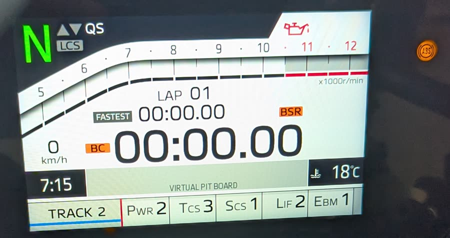

# The fourth capture, 2026-10-16: the Track display, and the wheels turning

> The write-up of this session, as it was written on the day. The current state of every
> signal is in [r9-signals.md](../../r9-signals.md); where a later session corrects
> something here, that page has the correction.

[`captures/session-2026-10-16_191234/`](./):
`tools/2-session.sh --ack`, 19:12:55 to 19:24:02, 328 502 frames, 14 marks, the same 23 ids
at 506 frames a second, nothing transmitted. The first of two captures that evening at a
standstill, with both wheels off the ground on stands; the second is
[session-2026-10-16_192421](../session-2026-10-16_192421/README.md), taken straight after
with the ignition left on.

**The CANable's 120 Ω terminator was on** for this session, as
[stand-session.md](../../stand-session.md) asked — the rider's word, 2026-10-16. The
session script has no field for it, so `notes.txt` does not say. There were no bus errors.

What was done, in order: the Track display and Track 1–4 (19:15–19:16), the rear wheel
turned by hand (19:17:14–27), the front by hand (19:18:29), then the engine — started
19:20:11, stalled 19:20:35.7, restarted 19:20:41.7, stopped with the stop switch
19:21:18.0 — the launch-control setting on and off with the engine off (19:22:31, 19:22:52),
and back to the normal display (19:23:34).

**In `other/`**, not in git; their hashes are in `SHA256SUMS`:

- `PXL_20261016_171946620.TS.mp4`, 107.7 s from a phone beside the rear wheel. A Pixel
  names the file with the time it began, in UTC: 19:19:46.620 local. Its `creation_time` is
  when it ended, 107.7 s later. It covers both engine runs. The camera stands still from
  about 10 s in.
- Four photos of the dash, one in each Track mode, named the same way: 19:15:52.5,
  19:16:07.7, 19:16:17.8, 19:16:29.9. They are in git as crops, `other/dash-track1.jpg`
  to `dash-track4.jpg`.

Each photo is also in git at a quarter of its width and height, under its own name with
`-small` added, JPEG quality 80, without the phone's metadata (2026-10-17).

Video and capture are lined up by when the wheel starts, stops and slows, and they agree to
half a second without any correction. The tool's fit over the steady stretch puts the
offset at +0.1 s. The phone's clock is used as it stands.

## The Track display

**`0x76E` byte 2 is `0x20` on the normal display and `0x10` on the Track display.** It
changed at 19:15:09.7, when the display was switched to Track, and back at 19:23:34.2, when
it was switched back. Both times it moved in the same frame as the mode field. Every
`0x76E` frame in the two earlier acknowledged captures has `0x20` there. One switch each
way, so it is a candidate for the display setting, from two changes.

**The Track display brings no new ids.** It is the same 23 ids, and from 19:15:11 to the
first wheel test at 19:17:10 the only nibbles that moved and had not moved with the normal
display (19:12:56–19:15:08) were the TCS and mode ones, which changed with the modes.

## Track 1–4, and what the 2-bit field is

Switching the display to Track selected Track 1 by itself, at 19:15:09.5. The four modes
were then stepped 2, 3, 4, 1. The dash was photographed in each one:

| Mode | Dash: PWR, TCS, SCS, LIF, EBM | `0x27C` b3 | TCS (`b3 >> 1`) | `0x27C` `b4 >> 6` | `0x76E` b1 | On the bus from |
|---|---|---|---|---|---|---|
| Track 1 | 1, 1, 1, 2, 1 | `02` | 1 | 0 | `00` | 19:15:09.5, and 19:16:22.0 |
| Track 2 | 2, 3, 1, 2, 1 | `06` | 3 | 1 | `01` | 19:15:45.1 |
| Track 3 | 3, 4, 2, 3, 1 | `08` | 4 | 2 | `02` | 19:15:55.3 |
| Track 4 | 3, 6, 2, 3, 1 | `0C` | 6 | 2 | `02` | 19:16:10.2 |

*Track 2, photographed at 19:15:52. The settings are along the bottom of the display.*

**The 2-bit field is the PWR setting, less one.** In all four modes, `0x27C` `b4 >> 6` and
`0x76E` byte 1 are PWR − 1. Track 3 and Track 4 have the same PWR and different TCS, and
the field stayed at 2 between them while byte 3 changed. Read the same way, the earlier
captures' values say sport is PWR 2, street PWR 3, rain PWR 4 and custom 1 PWR 1. Those are
predictions from the field, not readings of the dash.

**TCS has four more anchors**: 1, 3, 4 and 6, all as `b3 >> 1`. That makes 9 of 9.

**SCS and LIF changed again and nothing on the bus did.** From Track 2 to Track 3 they went
from 1 to 2 and from 2 to 3, and the only bytes that moved were `0x27C` byte 3, `0x27C`
byte 4 and `0x76E` byte 1. The other three steps left SCS and LIF unchanged. EBM was 1 in
all four modes and was never stepped.

## The rear wheel

**`0x756`, `b1 << 8 | (b0 & 0xF0) | b2 >> 4`, follows the rear wheel, at 700 counts per
revolution a second.** The video's speed comes from `tools/6-wheel-from-video.py`. A camera
standing still sees the same picture each time the wheel has gone round once, so the lag at
which a patch of the sidewall best matches itself is one revolution. Over the steady
stretch in first gear, 24 windows of 1.5 s from 19:20:49 to 19:21:01, the wheel turned at
2.19 to 2.34 revolutions a second. The field divided by that was 700.6 per revolution a
second, with a standard deviation of 1.0 %. The windows are in
[`other/wheel-from-video.csv`](other/wheel-from-video.csv).

**As 0.01 km/h a count, that is a wheel 1.946 m round**, and the tyre is a Bridgestone
180/55 ZR17. Its nominal circumference unloaded is about 1.98 m, so 1.95 m rolling is what
it should be. Where the unit comes from is that fit and nothing else: no dash speed was
noted, so this is the scale in km/h at a guess. It is one that lands on the tyre.

The 16-bit layout is how it reads, not something the capture tested. The highest value seen
was 1 709, `b1` = `06`, so nothing above bit 11 has been seen set. `b0`'s low nibble was 0
in every frame. `b2`'s low nibble is the start-sequence state already listed for `0x756`
(`06` to `0B` through the start).

**`0x27C` byte 2 is the rear wheel's pulses, counted per frame.** It reads 0, 1 or 2 in
each 10 ms frame while the rear wheel turns, and 0 at all other times. Summed over a
stretch, it gives 46.4 pulses for each revolution `0x756` accounts for, in three stretches
out of four: 91 pulses by hand (19:17:14–30), 1 885 through the second engine run, and 80
by hand in the next capture. The slow drag of the first run gives 47.1, because there
`0x756` reads zero for the slowest part. Against the video directly the figure is 46.2, sd
1.0 %, in the same 24 windows. So the rear sensor ring has 46 teeth, at a guess, from that
figure. The pulses keep counting below the speed at which `0x756` shows anything: they
started at 19:20:11.5 and the field at 19:20:13.4. This settles the earlier guess about
byte 2. Read this way, the six single `01` frames while the bike was being lifted on
2026-10-11 are the wheel turning a fraction as it came off the stand, which is what they
were guessed to be.

**The engine and the wheel turned at 11.93 to 1 in first gear**, 11.89 to 11.94 in each of
the nine seconds from 19:20:52 to 19:21:00, so the clutch was not slipping. If the
manual gives the primary, first-gear and final ratios, their product checks the wheel scale
without the video.

**In neutral the clutch drag turns the rear wheel.** From 19:20:13 to 19:20:35 it turned
at 0.21 to 0.29 revolutions a second, and `0x756` read 100 to 215. At that speed a
revolution lasts four seconds or more and the method is at its edge: in the five windows
where the match is sharp (contrast 2 or more) the field gives 675 to 700 per revolution a
second, and elsewhere anything from 410 to 700, the low ones being a match at the wrong lag.
Those windows are in [`other/wheel-from-video-drag.csv`](other/wheel-from-video-drag.csv).
It agrees with the first-gear figure and adds no precision to it.

## The front wheel

**`0x765`, `(b2 >> 4) << 8 | (b6 >> 4) << 4 | (b3 & 0x0F)`, follows the front wheel when the
front alone turns.** Pushed by hand at 19:18:29, it rose to 747 and ran down to zero over
six seconds. The rear's `0x756` was zero, with no pulses, until the second push. The next
capture has another push, to 725. `0x765` is zero at rest; its other bytes are the noise
already listed in `b4`'s low nibble, a constant `2` in `b6`'s low nibble, `b7` bit 4
flickering with the engine running, and `b1` bit 0, below. Its scale
has not been measured against anything. That it is the same as `0x756` comes from the
stretch below, where the two read the same.

## Two things that do not fit one field per wheel

**From 19:20:47.6 to the stop, `0x765` carried the rear wheel's speed.** In the second
engine run both fields rose in the same frame, to the same value, `0x033`. From
19:20:48.5 to the stop, each of the 295 `0x765` frames carried exactly the value of the
`0x756` frame before it: through first gear, down after the shift to neutral, and along
the clutch drag at 107–207. The front wheel was standing
still in its stand throughout. In the first run, 25 seconds earlier, the rear turned at up
to 2.15 km/h in neutral and 5.8 km/h for the moment first gear went in, and `0x765` stayed
at zero. So something between the two runs made the front field take the rear's value.
That is the ABS unit's fail-safe at a guess: a front sensor that reads nothing while the
rear turns at 15 km/h is the fault it is built to see. In the next capture, without a key
cycle, the front field was the front wheel again.

**The ABS lamp was lit at 19:15–19:16**, before the engine had run, in all four dash
photos. An ABS lamp normally stays on from key-on until the bike has moved, so on its own
this is not a fault. The rider's account is that nothing but the oil lamp was on; the
photos show the ABS lamp as well. No photo from the engine runs shows whether it went out
when the rear wheel turned.

**A second push of the front wheel moves `0x756` without the rear wheel turning.** At
19:18:30.8 and 19:18:32.2, each time the turning front was pushed again, `0x756` rose to
278 and then 397 and ran down to zero within three and a half seconds. `0x27C` byte 2
counted no pulse, and it counts below the speed at which `0x756` shows anything. The next
capture repeats it once, to 272, gone in two seconds. The first push from standstill did
not do it, in either capture. So `0x756` is not the
rear sensor's own reading but a value something has worked on, and what it is does not
show at a standstill. With the rear wheel turning by itself or under the engine, it agrees
with the pulses to 1 %.

## The engine runs

| When | What |
|---|---|
| 19:20:08.5 | `0x755` b6 bit 0 set, 2.6 s before the start, to 19:20:12.6. In the next capture it follows the clutch and the brakes |
| 19:20:11.1 | `0x27C` b3 bit 0 for 0.55 s; engine speed from 19:20:11.1; `0x27C` b6 bit 7 set at 19:20:11.7 |
| 19:20:35.6 | first gear with the sidestand down: `0x27C` b3 bit 5 and `0x765` b1 bit 0 set, `0x751` b6 `00` for 0.2 s, and the engine cuts out. The rider's account: the sidestand switch |
| 19:20:41.7 | restart. `0x27C` b6 bit 7 clears for 0.33 s and sets again |
| 19:20:45.8 | first gear: `0x27C` b3 bit 5 and `0x765` b1 bit 0 set, held to 19:21:02.3 |
| 19:20:47.5 | the clutch out: `0x751` b6 `60` → `20`, back to `60` at 19:20:49.0; the wheel moving from 19:20:47.6 |
| 19:21:02.3 | neutral; both bits clear |
| 19:21:05.4, 19:21:11.4 | `0x383` b4 bit 3 for 0.9 and 1.6 s: the brake, which the next capture names; the wheel slows to zero at both |
| 19:21:12.1 | `0x751` b6 `60` → `70`, 30 s after the restart, as in both earlier starts |
| 19:21:15.9 | `0x27C` b3 bit 0 for 0.14 s, with the engine running. One occurrence, unexplained |
| 19:21:18.0 | stopped with the stop switch: `0x751` b6 back to `60`, the wheel stops |

**`0x27C` byte 6 bit 7 does not clear when the engine stops.** It stayed set after the
cut-out at 19:20:35.7, after the stop switch at 19:21:18.0, and through all of the next
capture, with the ignition on. It cleared only at the restart, for a third of a second. So
"set while the engine runs" was wrong. The capture of 2026-10-11 20:06 agrees: it stopped
the engine at 20:21:23.8 and ran on to 20:21:58.4 with the bit still set, although its
write-up says it cleared. What the bit does is set at the first start after key-on and
clear briefly on each later one. When it clears at key-off has not been seen.

**`0x27C` byte 3 bit 5 and `0x765` byte 1 bit 0 are set in gear with the engine running**,
both times first gear went in, from the same frame to the same frame. They are not set in
second gear with the engine off (the next capture), so they are not the gear switch alone.

**`0x755` byte 6 bit 0 was set from the restart at 19:20:40.8 to the stop at 19:21:18.8
without a break**, while the rear wheel was driven in first gear. In the next capture it
follows the clutch and both brakes, so this was not the clutch lever held. Its high nibble
went `F` → `0` and back six times in the same stretch; unexplained.

## The launch-control setting

Turned on at 19:22:31 and off at 19:22:52 with the engine off. Nothing changed that does not
also change at rest. Like SCS, LIF and QS, it is a setting the bus does not carry.

## Looked for and not found

- **A bit for the Track display other than `0x76E` byte 2**, or any id that comes with it.
- **SCS and LIF**: two more changes, nothing.
- **The launch-control setting**: one on and one off, nothing.
- **A dash speed**: not noted, so the km/h is a fit to the tyre, not a reading.

## Next

- What makes `0x765` take the rear's value, and what moves `0x756` when the front is
  pushed. A photo of the dash during a run would show whether the ABS lamp is involved.
- A dash speed, or the gearing from the manual, to put the 0.01 km/h on more than the
  tyre's size.
- The front's scale, against anything: the dash, a video of the front wheel, or the rear's
  when the bike is pushed.
