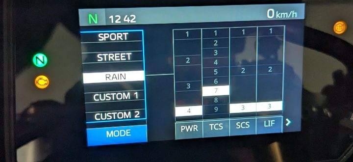

# The sixth capture, 2026-10-17: the rear wheel by hand, and up to 59 km/h in third

> The write-up of this session, as it was written on the day. The current state of every
> signal is in [r9-signals.md](../../r9-signals.md); where a later session corrects
> something here, that page has the correction.

[`captures/session-2026-10-17_123714/`](./):
`tools/2-session.sh --ack`, 12:37:39.7 to 12:43:15.9, 163 250 frames, 6 marks, the same 23
ids at about 507 frames a second, nothing transmitted. At a standstill, both wheels off the
ground on stands. Whether the CANable's terminator was on was not noted.

What was done, in order, from the marks, the frames and the rider's account (2026-10-17):

| When | What |
|---|---|
| 12:38:58–12:39:31, 12:39:36–12:39:59 | the rear wheel turned by hand, twice. The rider aimed at ten turns each time and thinks one of the two was a turn more |
| 12:40:32.5 | engine started |
| 12:40:44.3 | neutral to second gear, clutch out at 12:40:46.3 |
| 12:40:53.9 | third gear, and left there at about idle |
| 12:41:10.87 | the BC lamp on (below) |
| 12:41:14–12:41:17 | the engine run up to 3 721 rpm, the rear wheel to 59.0 km/h |
| 12:41:27.2 | engine stopped with the stop switch, still in third |
| 12:41:31–12:41:47 | the box shifted down to neutral with the engine off |
| 12:41:54.2–12:41:59.3 | key off and on again: the bus is silent for 5.1 s |
| 12:42:11.7 | engine started again, in neutral; it idled until 12:43:10.2 |
| 12:42:47–12:42:52 | the five ride modes photographed in the dash's mode menu |
| 12:43:15.9 | key off, the end of the capture |

The marks `rear_wheel_start` and `rear_wheel_end` (12:40:39.3, 12:41:37.2) bracket the
first engine run.

**In `other/`**, not in git; their hashes are in `SHA256SUMS`. A Pixel names a photo with
the time it was taken, in UTC, so the names below are local time two hours on.

- `PXL_20261017_104110974.jpg`, the dash at 12:41:10.974 with the BC lamp lit. In git as
  the crop `other/dash-bc.jpg`.
- `PXL_20261017_104247617.jpg` to `PXL_20261017_104252442.jpg`, the mode menu at
  12:42:47.6, 48.8, 50.1, 51.2 and 52.4: sport, street, rain, custom 1, custom 2. In git as
  the crops `other/modes-sport.jpg` and the rest.

The rider also counted the holes in the rear wheel's sensor ring by hand and filmed it.
That video is not in this folder.

## The rear sensor ring has 46 holes, and byte 2 counts every one

The rider counted **46 holes** on the ring, by hand, with a video to check against.

`0x27C` byte 2, summed over each turn by hand, gave:

| Stretch with pulses | Pulses | ÷ 46 |
|---|---|---|
| 12:39:03.3–12:39:27.5 | 507 | 11.02 |
| 12:39:38.6–12:39:56.9 | 462 | 10.04 |

507 is 11 × 46 + 1 and 462 is 10 × 46 + 2: eleven turns and ten, with a hole or two over
where the wheel was let go. That is the turn more the rider thought one of them had.
**So byte 2 is a raw count, one pulse a hole**, and the 46.4 a revolution of 2026-10-16,
which came from `0x756` and a video, was 0.9 % high. A stretch of 29 pulses at
12:38:43–12:38:49, before the first mark, is the wheel being moved into place.

## The wheel speeds above 40.95 km/h

In the run-up at 12:41:14–12:41:17 the rear wheel passed 40.95 km/h, 4 095 counts, the
most twelve bits hold. The rear's field as written up to now had its next bit in byte 1's
high nibble, and the front's had none known. Neither was where the next bit went.

**`0x756`: the next bit is `b3` bit 4.** The frame at 12:41:15.0, `F00F2B04…`, reads 4 082
by the old layout; the next, `80009B14…`, reads 137, and byte 3 has gone from `04` to
`14`. Bit 4 of byte 3 stayed set until 12:41:17.6, while the twelve bits counted up from
zero again and back down. Read as bits 12–15, `b3 >> 4` makes the speed continuous: the
largest step between neighbouring frames in the whole capture is 534 counts with it and
3 945 without. Byte 1's high nibble, which the old layout had as bits 12–15, has been zero
in every frame of all six captures. So the rear is

```
(b3 >> 4) << 12 | (b1 & 0x0F) << 8 | (b0 & 0xF0) | b2 >> 4
```

four nibbles, as the front's are. Only bit 12 has been seen set, in 51 frames; bits 13–15
are the rest of the nibble, at a guess, which would end the field at 655 km/h. Byte 3's
low nibble is not part of it: it read 3 to 5 through the run-up, and moves at starts and stops.

**`0x765`: the top nibble is `b0 >> 4`**, as Bluecan's guess of 2026-10-16 had it
([open question 10](../../open-questions.md)). Its bit 4 was set from 12:41:15.1 to
12:41:17.5, 25 frames, in the same frames as the rear's, and with it the front field read
the same value as the rear's last frame in every one of them: 4 308, 4 506 … 5 838. So the
front is `(b0 >> 4) << 12 | (b2 >> 4) << 8 | (b6 >> 4) << 4 | (b3 & 0x0F)`. Again only bit
12 has been seen.

The highest values: 5 904 in `0x756` at 12:41:16.9, 59.0 km/h at 0.01 km/h a count, at
3 721 rpm a frame earlier.

## The scale against the dash

**The photo at 12:41:10.974 shows 28 km/h.** Over 12:41:09.5–12:41:11.0 `0x756` averaged
2 518, 25.2 km/h. The dash reads 2.8 km/h, 11 %, above the field. A speedometer is built
to read high; the EU allows it up to 10 % plus 4 km/h over and never under, and 28 is
inside that. So the dash agrees with 0.01 km/h a count as far as a dash can, and cannot
pin it closer. One photo. The rider's recollection — about 30 km/h falling to 28 at idle,
and about 60 at nearly 4 000 rpm — fits the field's 25–32 km/h in third and its peak of
59.0, with the same caveat.

**The pulses give 697 counts per revolution a second**, now that they count the
revolutions without a video:

| Stretch | Gear | Pulses | `0x756` mean | Counts per rev/s |
|---|---|---|---|---|
| 2026-10-16 19:20:52–19:21:00 | 1 | 859 in 8.00 s | 1 626 | 696.5 |
| 12:40:47.5–12:40:53.5 | 2 | 930 in 6.00 s | 2 348 | 696.8 |
| 12:40:55.5–12:41:13.5 | 3 | 3 163 in 18.00 s | 2 664 | 697.3 |
| 12:41:18.5–12:41:26.0 | 3 | 1 559 in 7.49 s | 3 156 | 697.6 |

Counts per revolution a second is the field's mean divided by (pulses ÷ 46 ÷ seconds).
At 0.01 km/h that is a wheel 1.936 m round, which the 180/55 ZR17 tyre is. The video of
2026-10-16 gave 700.6, 0.5 % more.

**At 12:42:47–12:42:52 the dash showed 0 km/h** while the rear wheel turned on clutch drag
in neutral, `0x756` reading 149 to 188, and `0x765` read zero. Whether the dash takes the
front's field, or shows nothing below a few km/h, this does not separate.

## The gearing, from the bus alone

With 46 pulses a revolution, engine speed against wheel speed needs nothing outside the
bus: rpm ÷ 60 ÷ (pulses ÷ 46 a second), over the stretches above.

| Gear | Engine to wheel | ÷ 79/47 × 43/16 |
|---|---|---|
| 1 (2026-10-16) | 11.866 | 2.627 |
| 2 | 8.786 | 1.945 |
| 3 | 7.313, 7.318 | 1.619, 1.620 |

The last column divides out the primary and secondary ratios from the service manual,
4.5174, leaving what the gear itself would be. **First gear does not fit the owner's
manual's 36/14, 2.571**: the bus says 2.2 % more. The video of 2026-10-16 said 11.93, 0.5 %
from the bus, so it is not the video that was off, as was assumed on 2026-10-17 before this
capture.

**Second and third agree with the owner's manual to 0.1 %.** Its table, as the rider read
it on 2026-10-17: 36/14 = 2.571, 37/19 = 1.947, 34/21 = 1.619, 29/21 = 1.381,
25/21 = 1.190, 28/27 = 1.037. The bus gives 1.945 and 1.619–1.620 for second and third.
So the 2.2 % is first gear's alone, and the likely reason is in `0x751` byte 6:

| Stretch | `0x751` b6, bits 5–6 |
|---|---|
| first gear, 2026-10-16 19:20:49.0–19:21:02 | `60` |
| second gear, 12:40:46.3–12:40:53.2 | `20` |
| third gear, 12:40:54.6–12:41:26.5 | `20` |

In second and third, `60` came back exactly when the clutch was pulled, for the shift at
12:40:53.2 and before the stop at 12:41:26.5, and `20` when it went out. In first on
2026-10-16 it read `20` for only 1.6 s after the clutch went out, and then `60` while the
wheel was driven. Read this way, the clutch lever was held partly in through the first-gear
stretch and the clutch slipped by 2 %. Second by second the ratio there was 12.04 for the
first three seconds and 11.80–11.94 after, which is what a clutch taking up would do. A
guess, with a test: first gear again with the lever let fully out, where byte 6 reads `20`,
should give 11.616.

## Second and third gear: `0x27C` bits 29–31 are the gear

| | `0x27C` b3 | `(b3 >> 5) & 0x07` | `0x765` b1 |
|---|---|---|---|
| second, engine running, 12:40:44.3 on | `46` | 2 | `02` |
| third, engine running, 12:40:53.9 on | `66` | 3 | `03` |

First gear on 2026-10-16 set bit 5 alone, `22`. **So bits 29–31 are a 3-bit gear**,
where AiM's R1 file has `ECU_GEAR`, and `0x765` byte 1's low three bits carry the same
number in the same frames. It is not the gear box's own field in byte 4:

- between second and third, byte 4 read `7` for 0.2 s (12:40:53.7–12:40:53.9); bits 29–31
  stayed at 2 and went straight to 3;
- when the engine was stopped in third (12:41:27.2) and the box went down through `7`, 2
  and N with the engine off, bits 29–31 stayed at 3, until the key went off and on again;
  the first frame after key-on has them at 0.

So it is the gear as the ECU last had it with the engine running. Open question 9 is
answered: second gear sets bit 30 alone, third both.

## The BC lamp and the engine lamp

The rider's account: after a while in third the BC lamp came on, and then the engine lamp,
both with the engine still running in third. After the key was turned off and on, BC was
out. The photos agree: BC lit and the engine lamp dark at 12:41:10.974; the engine lamp
lit in all five photos at 12:42:47–12:42:52.

Two bits that had never been set in any earlier capture set at that moment:

| Bit | Set | Cleared |
|---|---|---|
| `0x27C` b4 bit 3 | 12:41:10.868 | 12:41:59.634, 0.3 s after key-on, and not set again |
| `0x383` b0 bit 2 | 12:41:10.919; the frame before, at 12:41:10.818, had it clear | not in this capture: still set after key-on, to the end |

The photo is 0.11 s and 0.06 s after them by the two clocks, the phone's and the laptop's, which
agreed to about half a second on 2026-10-16; so the photo is close to the moment, and
which came first, photo or bits, the clocks cannot say.

**`0x27C` byte 4 bit 3 behaves as the BC lamp**: set within the clocks' half second of the
photo that shows the lamp, held through the stop and the key-off, gone after key-on, as
the lamp was. One
occurrence; a candidate. Byte 4's other bits are the gear (0–2) and PWR (6–7).

**`0x383` byte 0 bit 2 stayed set after the key cycle**, as the engine lamp stayed lit. But
the rider saw the engine lamp come on some time after BC, and the photo near the moment
the bit set shows it dark. So if this bit is what lights the lamp, the lamp follows it with
a delay; or the bit is a fault flag that goes with it. A candidate for the engine fault, at
a guess, one occurrence. It is the second bit ever to move in `0x383`, after the brake.

The likely cause: the rear wheel had been driven for half a minute, at 25–29 km/h by then,
with the front standing still, which is what a wheel-speed check is there to catch. The lamps were not cleared
during the session.

## The front field copies the rear

**During the turns by hand, `0x765` took the rear's value.** From the first movement at
12:38:44 to 12:39:11, with the rear at up to 5 km/h, it read zero. From 12:39:12 it rose
towards the rear's value, 400 counts below it at first and closing over four seconds, and
from 12:39:16.1 it was the rear's exact value in every frame: 298 frames to the end of the
second turn by hand, and 539 of 539 in the engine run. The front wheel was not touched. On
2026-10-16 the rear turned by hand for 13 s and the front field stayed at zero, 49 frames.

**After the key cycle it did not copy.** In the second run the rear turned on clutch drag at
up to 2.6 km/h, 567 frames, and `0x765` read zero in all of them.

So the copy sets in after some seconds of the rear turning alone, faster than a few km/h at
a guess, and it is blended in rather than switched. That is a substitute value of the ABS
unit's, at a guess, as before ([open question 8](../../open-questions.md)).

## Key-off, twice, and key-on

The bus goes quiet at key-off: at 12:41:54.2 and at 12:43:15.9. In the last frames before
each silence, in both:

- `0x27C` byte 3 bit 0, the bit that is set as the starter turns, is set;
- `0x27C` byte 6 bit 7 clears. **So that bit is cleared at key-off**, which had not been
  seen; with what was known, it is set from the first start after key-on to key-off, and
  clears for a third of a second at each restart;
- `0x751` byte 3 bit 3 is set. It is set and cleared in the same frames as `0x27C` byte 3
  bit 0 at every edge in this capture, seven, starts and key-offs alike;
- `0x383` byte 4 bit 3, the brake, is set in the last `0x383` frame. Whether the brake was
  on is not known.

At key-on, 12:41:59.3, `0x76D` byte 1 bits 0, 2 and 3, `0x76D` byte 2 bit 7, `0x76A` byte 3 bits 2 and 3 and
`0x76A` byte 5 bit 7 change for one frame.

`0x751` byte 3 bit 1 is clear while the engine runs and set otherwise: it cleared at both
starts, 12:40:32.5 and 12:42:11.7, and set at both stops, 12:41:27.2 and 12:43:10.2.

## The ride modes in the menu

The five photos of the mode menu, PWR, TCS, SCS and LIF as the menu shows them (EBM and
the rest are on the next page of the menu, not photographed):

| Mode | PWR | TCS | SCS | LIF |
|---|---|---|---|---|
| sport | 2 | 3 | 2 | 2 |
| street | 3 | 5 | 2 | 3 |
| rain | 4 | 7 | 3 | 3 |
| custom 1 | 1 | 4 | 2 | 3 |
| custom 2 | 2 | 3 | 3 | 3 |



*Rain, at 12:42:50. The engine lamp is the amber one under the green N.*

The first capture's five states, read as (TCS, PWR) by the fields as they are now named,
were (3, 2), (5, 3), (7, 4), (4, 1) and (4, 3). The first four are sport, street, rain and
custom 1 exactly, as the field had predicted on 2026-10-16. The fifth fits none of the five
as they are now; custom 2, now (3, 2), is the only one it could have been. The custom modes can be
changed, and in that first capture the modes were being changed to see whether the bus
showed it (the rider, 2026-10-17), so a custom 2 set differently then is no surprise.

The mode during both runs was custom 2: the photo at 12:41:10.974 shows PWR 2, TCS 3,
SCS 3, LIF 3, EBM 2, and third gear, and the fields read TCS 3, PWR 2 and gear 3. Browsing
the menu in the second run changed nothing on the bus.

The same photo shows coolant 21 °C and air 18 °C. `0x512` read 23.75 and 20.0 by the
equations at 12:41:10.7. The air is the 1–2 °C the dash always shows less. The coolant is
2.75 °C under, more than the 2 °C of the six earlier anchors; it was rising 0.3 °C a
second, and a dash that lags would read low.

## Anything else that moved once

- `0x27C` byte 5 bit 3, 12:41:14.5–12:41:16.4, in the run-up. Byte 5 had been zero in every
  frame of every capture until then. Unexplained.
- `0x765` byte 6 bit 1, the constant `2` in byte 6's low nibble: clear from 12:40:54.7,
  when the clutch went out in third, to 12:41:26.5, just before the stop. It did not clear
  when the clutch went out in second. Unexplained.

- `0x383` comes ten times a second, here and in all four earlier acknowledged captures,
  not twice as the pages said up to now.

## Looked for and not found

- **First gear** was not engaged: the box went from N to second at 12:40:44.3.
- **A bit for the engine lamp that sets after the BC bit**: nothing else set and stayed set
  between 12:41:10.9 and the stop at 12:41:27.2.
- **The video of the hole count** is not here, so the 46 is the rider's count.

## Next

- First gear with the engine running and the clutch lever let fully out, `0x751` byte 6
  reading `20`: 11.616 would make first gear's 2.2 % the clutch.
- Whether the BC and engine-lamp candidates repeat: the same run on the stand would set
  them again, and a key cycle should clear the first and not the second. Clearing the
  stored fault is a dealer's job or a diagnostic tool's, which this project does not use.
