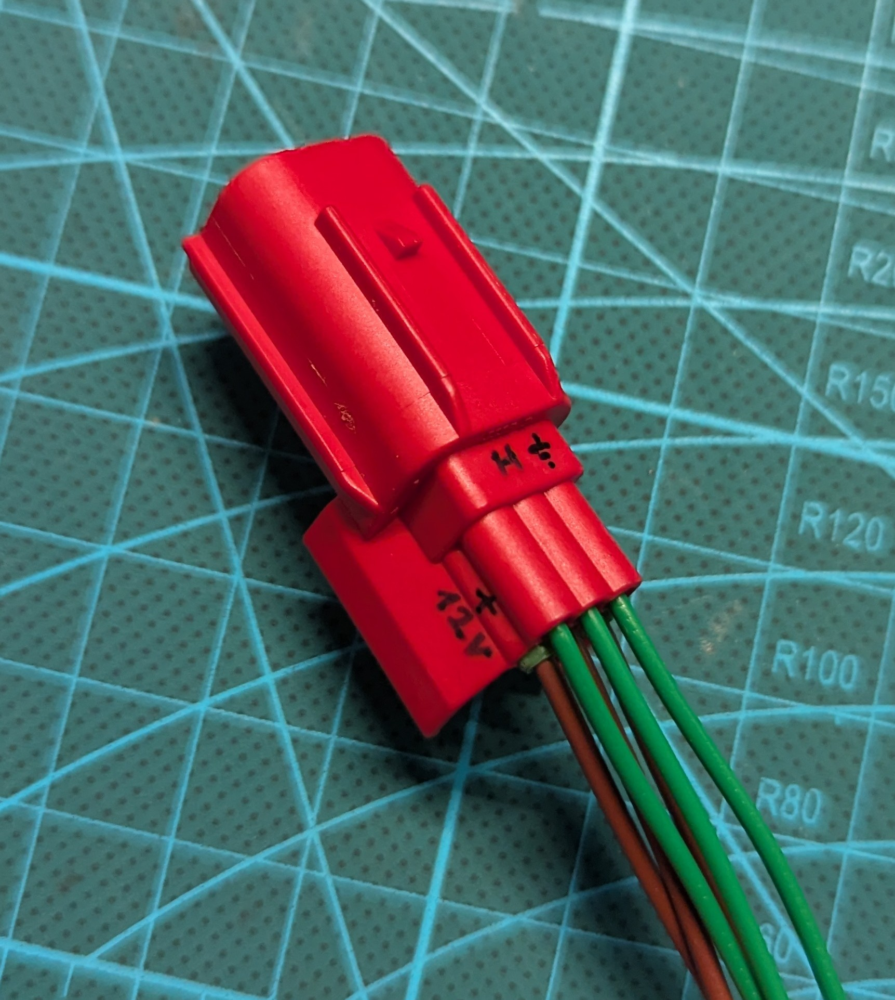

# The diagnostic connector, and finding the CAN pair on it

Where the adapter goes. The R9 has the red 6-pin Euro5 connector (ISO 19689) under the
seat; the service manual calls it the YDT coupler.

| Pin | Function | Measured on the R9, 2026-10-10 |
|---|---|---|
| 2 | CAN High | 3.2 V against ground, key on |
| 3 | Ground | 0 Ω to battery negative |
| 4 | Battery +12 V, unswitched | 12 V with the key off. Left unconnected |
| 5 | CAN Low | 1.7 V against ground, key on |
| 6 | K-line | not used here |

*The pigtail after metering, from the wire side, latch up: `H` on CAN High with ground
beside it, `+12V` at the opposite corner.*

500 kbps. About 120 Ω across the pair with the key off: one terminator, not two. The pair
has only the ECU on it ([R9_CANbus.md](R9_CANbus.md)), so the ECU's frames go unanswered
unless the adapter acknowledges them — see the
[first](captures/session-2026-10-11_115626/README.md) and
[second](captures/session-2026-10-11_130905/README.md) captures.

What follows is how the pinout was established before a pigtail was in hand, kept as it was
written: which pictures number which face of the connector, and how not to hold it upside
down. `[S7]` and the other source tags are listed in
[background/pre-bike-mapping.md](background/pre-bike-mapping.md#sources).

## How the pins were found

**The pigtail lead is now specific, and it is probably not the 4-pin one.** [S7] gives
the connector for both eras of the R9's own platform, with pin functions:

| | Connector | Pins |
|---|---|---|
| MT-09 2014–2020 | 4-pin Sumitomo, under the **tail** | Blu/Red = CAN High, Blu/Black = CAN Low, Red/Black = +VB (unswitched), Black = GND |
| MT-09 **2021+ Euro5** | standard **OBD-II Euro5 red connector, under the seat** | 2 = CAN High, 3 = GND, 4 = battery voltage, 5 = CAN Low |

The 2021+ row is the ISO 19689 6-pin red connector that Euro5 made standard, and the R9 is
a Euro5+ bike on that platform, new for 2025, so that — not the older Yamaha 4-pin — is what to
match when sourcing. Confirm against the R9's own owner's manual before buying; that
confirmation has not been done here. Adapters for it are sold as "6-pin red Euro5 to
OBD2".

**Finding the CAN pair on a bare pigtail needs no pin numbers.** [S7]'s photo of the red
connector ([copy](sources/aim-yamaha/euro5-connector-can-pins.png)) has no numbers on it,
only two arrows, and they are enough: the cavities are two rows of three, **CAN High is
the middle cavity of the row next to the latch, CAN Low is the middle cavity of the other
row.** That agrees with the table if the rows are numbered 1-2-3 and 4-5-6, which puts 2
and 5 in the middle column. The middle column is the useful part — it is the same cavity
from the mating face and from the wire side, and on either half of a mated pair, so the
left/right mirroring that makes pin numbers treacherous does not touch it. Only the rows
have to be told apart, and the latches of the two halves line up.

**Ground and battery are 3 and 4, from two vendors who do not share a source.** [S7] says
so for the MT-09, and KDS — a German adapter seller, citing ISO/DIS 19689 rather than any
one bike — prints the same table with the K-line added: 2 = CAN_H, 3 = Ground, 4 = VBAT
+12 V, 5 = CAN_L, 6 = K-Line, pin 1 unallocated
([copy](sources/aim-yamaha/kds-euro5-male-pinout.jpg), from
[their product page](https://kds-online.de/en/obd-adapter-euro5-for-motorcycle-6-pin-to-obd2-k-line-can-bus.html)).
Their picture is also the one that numbers the cavities, and it is of the **male** half —
the pigtail's half, since the standard makes the vehicle side female. Looking into the
male's mating face: `3 2 1` across one row, `6 5 4` across the other. The female is the
mirror image, `1 2 3` / `4 5 6`.

**AiM's own cable drawing says the same from the other side.** Page 2 of [S7]'s 2021+
guide ([copy](sources/aim-yamaha/aim-cable-scheme-insertion-view.png)) draws the male
connector as `1 2 3` over `4 5 6` and labels it *contact insertion view* — the face the
terminals are pushed into, so **the wires come towards you**. The Binder plug at the other
end of the same drawing is a *solder termination view*, which is the same convention: AiM
draws both ends from where the person building the cable stands. Mirrored, it is KDS's
`3 2 1` / `6 5 4` exactly, so the two pictures are one connector seen from its two ends,
and between them there is a numbered view for whichever end is in your hand. AiM's wire
colours (white, blue, red, orange, black) are AiM's cable's and say nothing about a
pigtail bought elsewhere.

An earlier version of this paragraph recorded a rival allocation (1 = GND, 4 = K-line,
6 = +12 V). That was a search engine's summary of a paywalled forum thread and no source
says it; KDS's own table came back scrambled the same way through a summariser and only
read correctly from the raw HTML. The standard itself was not read: ISO sells it, the free
iTeh preview stops one page short of Table 1, and UNECE's copy of the draft is behind a
bot wall.

**What the numbering does not protect against is holding the connector upside down.**
Turning it 180° swaps 3 with 4 as well as 2 with 5 — ground with battery — and the
populated cavities 2, 3, 4, 5 look identical both ways up. Two things break the symmetry:
[S7]'s photo puts CAN High in the row next to the latch, so that row is `1 2 3`; and if
the pigtail has a fifth wire it is the K-line on 6, in CAN Low's row, which leaves the
one empty cavity as pin 1 — ground is then at the far end of the
empty cavity's row, and battery is the cavity directly across from the empty one.

So count first and **meter before anything is screwed down**, because the meter does not
care which way up it was held: plugged into the bike with the key off, +12 V is
unswitched and reads 12 V against battery negative, ground reads 0 Ω to it, and the CAN
pair was expected to read about 60 Ω across — two terminators in parallel. The +12 V wire
is left unconnected and insulated; the CANable is powered from USB.

**The first thing measured on the R9, 2026-10-10: the pair reads about 120 Ω, not 60.**
Key off, pigtail alone, no adapter. That is one terminator visible from the diagnostic
connector, and it still identifies the pair — nothing else on this connector reads 120 Ω.
Why there is one and not two is not known: a bus this short can be built with a single
resistor, and a second one may sit in a unit that only joins the bus when powered. The
60 Ω figure was the textbook case and never a measurement. It changes one number at the
bike — with the adapter attached, 60 Ω is now the reading that means its own terminator
was left on — and nothing else.

**And which wire is which, the same day:** key on, engine off, against ground, CAN High
reads 3.2 V and CAN Low 1.7 V. High above 2.5 V and Low below it, symmetric about 2.45 V,
is the pair the right way round with frames moving on it. The spread is wider than the
few tenths of a volt predicted beforehand; a single terminator makes the dominant swing
larger, which fits the 120 Ω above, but a multimeter's average of a live bus says nothing
firmer than that.

**The pigtail now carries the answer on its own housing**
([photo](sources/r9/pigtail-verified-pins.jpg), 2026-10-10). Marked in pen on the male
half after metering, seen from the wire side with the latch up: `H` over the middle
cavity of the latch row with the ground mark beside it, and `+12V` on the other row, at
the corner diagonally opposite ground. That is `1 2 3` over `4 5 6` exactly as AiM's
insertion view draws it — CAN High on 2, ground on 3, battery on 4 — so the table above
holds on this R9, and CAN Low is the unmarked middle cavity of the lower row, the wire
that read 1.7 V. The wire colours do not help: in the photo the latch row is all green and
the other row brown.
